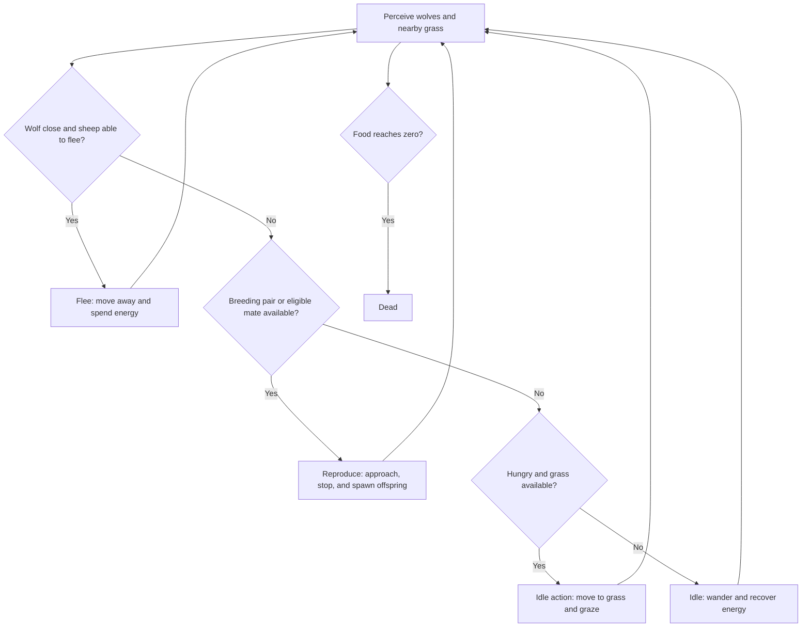
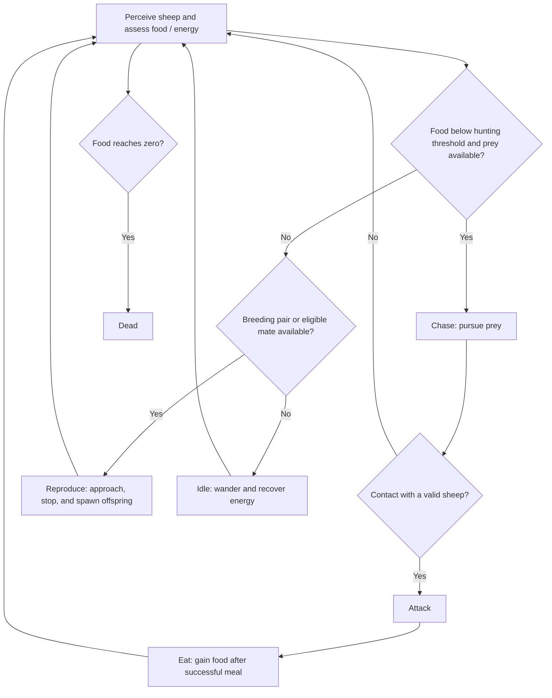

**Name :** Ryan Hulton

# Predator–Prey Ecosystem — Computer Science Workshop 3

**Project version:** v1.4 · **Unity Editor:** Unity 6.6 (`6000.6.9f1`) · **Programming language:** C#

A 3D ecosystem simulation in which **sheep, wolves, and grass** interact autonomously. Each animal perceives its surroundings, makes decisions through a finite-state machine (FSM), manages energy and hunger, reproduces under specific conditions, and eventually dies. Grass is generated and regrows over time, while a live HUD and population graph show the evolution of the ecosystem.

> **Start here:** This repository contains a **Unity project**, not a standalone executable. Open the project folder in **Unity Hub**, load `Assets/Scenes/SampleScene.unity`, and press **Play**. The following guide covers installation, every in-game control, all simulation mechanics, customization, and troubleshooting.

## Table of contents

1. [Requirements](#1-requirements)
2. [Downloading and opening the project in Unity](#2-downloading-and-opening-the-project-in-unity)
3. [Starting and stopping the simulation](#3-starting-and-stopping-the-simulation)
4. [Complete controls and keyboard shortcuts](#4-complete-controls-and-keyboard-shortcuts)
5. [Understanding the HUD and population chart](#5-understanding-the-hud-and-population-chart)
6. [How the ecosystem works](#6-how-the-ecosystem-works)
7. [Animal reproduction: complete rules](#7-animal-reproduction-complete-rules)
8. [Customizing the simulation in the Unity Inspector](#8-customizing-the-simulation-in-the-unity-inspector)
9. [Project structure and C# scripts](#9-project-structure-and-c-scripts)
10. [Finite-state machines](#10-finite-state-machines)
11. [Performance techniques](#11-performance-techniques)
12. [Recommended test scenarios](#12-recommended-test-scenarios)
13. [Troubleshooting](#13-troubleshooting)
14. [Extensions, design decisions, and limitations](#14-extensions-design-decisions-and-limitations)
15. [Credits](#15-credits)

---

## 1. Requirements

Before opening the project, ensure that you have:

- **Unity Hub**, for managing and launching Unity projects.
- **Unity Editor `6000.6.9f1` (Unity 6.6)**, the version recorded in `ProjectSettings/ProjectVersion.txt`. Opening the project with a different Editor version may trigger a migration or package updates.
- A computer capable of running a Unity 3D project with the **Universal Render Pipeline (URP)**.
- A **keyboard and mouse** for free-camera navigation.
- An Internet connection during the first import if Unity needs to resolve packages from `Packages/manifest.json`, including **Input System**, URP, and Unity UI.
- **Visual Studio Code or another C# editor (optional)**. You do not need it merely to run the simulation, but it is useful for reviewing and editing scripts.

**Input system:** This project uses `UnityEngine.InputSystem`, not the deprecated `UnityEngine.Input` polling API. The controls documented below reflect the scripts included with this version.

## 2. Downloading and opening the project in Unity

### 2.1 Get the project from GitHub

1. Open the project repository on GitHub and select the final project branch, normally `main`.
2. Select **Code → Download ZIP** and extract the downloaded archive. Alternatively, clone the repository with Git:

   ```bash
   git clone <REPOSITORY_URL>
   ```

3. Locate the **Unity project root**. This is the directory that contains **`Assets/`**, **`Packages/`**, and **`ProjectSettings/` directly**.
4. Start **Unity Hub**.
5. Open **Projects → Add → Add project from disk** (the exact label may vary with Unity Hub versions).
6. Select the project root identified in step 3. **Do not select a parent folder containing a second nested Unity project folder.**
7. Ensure the project uses **Editor `6000.6.9f1`**. If necessary, install that version through **Installs → Install Editor** in Unity Hub.
8. Open the project. On its first launch, Unity imports assets, compiles C# scripts, and resolves packages. Wait for these operations to finish before pressing Play.
9. In Unity's **Project** window, navigate to **`Assets → Scenes → SampleScene`** and double-click `SampleScene.unity`.
10. Open **Window → General → Console** if the Console is not already visible. Check for red compilation errors before starting the simulation.

### 2.2 Open a supplied ZIP archive

If you received the Unity project as a ZIP instead of a GitHub checkout, extract it first and follow steps 3–10 above. **Unity Hub opens the extracted directory, not the ZIP file itself.**

### 2.3 Expected project layout

```text
UnityProject/
├── Assets/
│   ├── Animations/
│   ├── Materials/
│   ├── Models/
│   ├── Prefab/
│   ├── Scenes/
│   │   └── SampleScene.unity
│   └── Scripts/
├── Packages/
├── ProjectSettings/
└── README.md
```

The `Library/`, `Temp/`, and other cache directories are created by Unity. They are generally not needed in the Git repository and should not be committed as source files.

### 2.4 If the scene does not open automatically

Double-click `Assets/Scenes/SampleScene.unity` in the **Project** window. The scene is also referenced in `ProjectSettings/EditorBuildSettings.asset`.

## 3. Starting and stopping the simulation

1. Open **`SampleScene`**.
2. Check the **Hierarchy** for `Main Camera`, `SimulationGenerator`, `GrassGenerator`, and `AnimalsHUD`.
3. Select the **Game** tab to see the view produced by the free camera. The **Scene** tab is for editing the environment, not for controlling the running camera.
4. Press the **▶ Play** button at the top of the Unity Editor.
5. Unity automatically spawns the configured sheep, wolves, and grass. Each animal acts independently; you **do not control individual animals**.
6. **Click inside the Game view** to lock the mouse cursor and control the free camera.
7. Navigate using the controls below. Press **Esc** to release the cursor and interact with Unity's Editor interface again.
8. Press the **▶ Play** button again to stop the simulation.

**Important:** Inspector values changed while Play Mode is running are usually temporary and may revert when Play Mode ends. To change default simulation settings permanently, stop Play, edit the scene or prefab, and save it.

### Video demonstration — two sheep and two wolves

The following recording shows a short run of the ecosystem with **two sheep and two wolves**, illustrating the autonomous simulation in action:

[**Watch the 47-second simulation demonstration (MP4)**](Media/Demo_2_sheep_2_wolves.mp4)

The recording is stored in the repository's `Media/` folder and can be opened in your browser or downloaded from GitHub.

## 4. Complete controls and keyboard shortcuts

These controls are based on `FreeCamera.cs`, `FreeCameraHUD.cs`, `HUDToggle.cs`, `PopulationPlot.cs`, and `SimulationSpeed.cs`.

### 4.1 Free-camera movement

| Key / action | Function |
|---|---|
| **Left-click inside Game** | Capture/lock the mouse cursor and activate free-camera control. |
| **Move the mouse** | Look around: rotate the camera horizontally and vertically. |
| **W** (QWERTY) / **Z** (AZERTY) | Move forward. |
| **S** | Move backward. |
| **A** (QWERTY) / **Q** (AZERTY) | Strafe left. |
| **D** | Strafe right. |
| **Up / Down arrow** | Move forward / backward. |
| **Left / Right arrow** | Strafe left / right. |
| **Space** | Move the camera vertically upward. |
| **Left Ctrl / Ctrl** | Move the camera vertically downward. |
| **Hold Shift** | Increase camera movement speed using the configured camera speed multiplier. |
| **Esc** | Release the mouse cursor and stop controlling the camera, so you can click on the Editor. |

**Keyboard-layout note:** The free-camera script supports the physical movement-key positions used by WASD, which correspond to **ZQSD** on many AZERTY keyboards. Arrow keys are also supported. Multiple movement keys can be held at the same time, such as forward + upward.

**If the camera does not move:** Focus the **Game** tab and click inside it once to capture the mouse. If your cursor is free, navigation is not active.

### 4.2 Help and statistics panels

| Key | Function |
|---|---|
| **F1** | Expand or collapse the free-camera help panel at the top center of the Game view. |
| **F2** | Show or hide the population-monitoring chart in the bottom-right corner. |
| **Tab** | Show or hide both animal-statistics panels (`SHEEP` on the left and `WOLVES` on the right). |

When the cursor is unlocked, a small reminder may remain visible to explain how to regain camera control. Hiding the population graph with F2 **does not stop data collection**; population samples continue to be recorded while the simulation runs.

### 4.3 Simulation-speed controls

| Key | Simulation speed | Meaning |
|---|---:|---|
| **1** | **×1** | Normal simulation speed. |
| **2** | **×2** | Two simulation seconds per real second. |
| **3** | **×4** | Four simulation seconds per real second. |
| **4** | **×8** | Eight simulation seconds per real second. |

The number row and corresponding **numeric keypad** keys are supported, with additional layout handling for some French and macOS keyboards.

These keys change `Time.timeScale`, affecting **animal motion, hunger, energy, searching, grazing, reproduction, the breeding cooldown, and grass regrowth**. The free camera uses unscaled frame time, so its speed remains largely independent of simulation acceleration.

For example, the **180-second breeding cooldown** takes approximately:

| Speed | Real time required |
|---|---:|
| ×1 | 3 minutes |
| ×2 | 1 minute 30 seconds |
| ×4 | 45 seconds |
| ×8 | 22.5 seconds |

**Note:** The **Shift** key affects *camera movement speed*, whereas **1–4** affect *ecosystem simulation speed*. They are different controls.

### 4.4 Unity Editor controls (not in-game animal controls)

| Editor action | Use |
|---|---|
| **▶ Play** | Start or stop simulation Play Mode. |
| **Pause button** | Pause the Editor's simulation. |
| **Game tab** | View the active camera and HUD. |
| **Scene tab** | Inspect and edit GameObjects and the environment. |
| **Hierarchy** | Select objects currently present in the scene. |
| **Inspector** | Edit component and prefab settings. |
| **Console** | Review error messages, warnings, and diagnostic logs. |
| **Ctrl + S** (Windows) | Save scene or editing changes. |

**There are no player controls for individual sheep or wolves.** They are autonomous agents. The user controls the camera, playback speed, and UI visibility.

## 5. Understanding the HUD and population chart

### 5.1 SHEEP and WOLVES side panels

`AnimalBarsHUD.cs` and `AnimalBarRow.cs` generate the panels and their rows automatically.

- The **left panel** is headed `SHEEP (number)` and displays the current living sheep population.
- The **right panel** is headed `WOLVES (number)` and displays the current living wolf population.
- Each animal gets its own numbered row, such as `Sheep 1`, `Sheep 2`, `Wolf 1`, or `Wolf 2`. Numbers may have gaps after animals die because existing animals are not renumbered.
- Each row includes a **Breeding** indicator and two status bars.
- **Energy:** yellow, fills **left to right**; its percentage is printed **outside the bar on the left**.
- **Food:** orange, fills **right to left**; its percentage is printed **outside the bar on the right**. The value represents the animal's current **hunger satisfaction/satiety**, not the amount of grass on the ground.
- `Energy` and `Food` labels appear above their respective bar columns.

**Breeding indicator:**

| HUD text | Explanation |
|---|---|
| `Breeding : OK` | The animal currently satisfies the conditions required to start breeding and is available. |
| `Breeding : ---` | Its cooldown has ended, but it is not currently eligible (for example, insufficient energy/food, incompatible state, or nearby threat). |
| `Breeding : 2m45s` | An active breeding cooldown. The countdown is shown **until it reaches zero**, even if the animal temporarily becomes ineligible. |

The panel list refreshes periodically using `Refresh Interval` (normally 0.5 seconds); each row updates its percentage and breeding countdown as the simulation runs. Panels are intentionally **single-column, without automatic scrolling**. With large populations, rows can extend beyond the bottom of the screen.

Press **Tab** to hide both panels, or press it again to show them.

**In-game example — sheep fleeing from wolves:**


*The scene shows sheep in motion, nearby wolves, individual energy/food bars, breeding status, and the live population chart.*

### 5.2 Population graph — F2

Press **F2** to open the **Populations** window at the bottom right. It displays:

- **Sheep:** light-blue line and current count.
- **Wolves:** orange line and current count.
- **Grass:** light-green line and current count.
- The current **simulation-speed multiplier** (`×1`, `×2`, `×4`, or `×8`).
- A scrolling history over `Window Seconds` (240 simulation seconds in the supplied scene).

The graph uses **two vertical scales** because grass usually outnumbers animals: the **left** axis measures animals, while the **right** axis measures grass.

`PopulationPlot.cs` automatically records population samples at `Sample Interval` (1 simulation second in the supplied scene). Sampling continues when the graph is hidden. A birth increases the corresponding animal population, a death decreases it, new grass increases the grass count, and eaten grass decreases it.

**Do not confuse an apparent flat line with a broken graph:** if animal counts remain unchanged, their curves remain flat even while grass grows rapidly. Use the left and right axis labels to interpret each series.

### 5.3 Camera help overlay — F1

The help window appears at the **top center** of the Game view. It summarizes navigation keys, mouse control, vertical movement, Shift, Esc, and the F1/Tab shortcuts. It belongs to `FreeCameraHUD.cs` and does not directly control animal behavior.

## 6. How the ecosystem works

### 6.1 Sheep — `SheepBehaviour.cs`

Sheep start with **100% energy** and **100% food**. Food decreases over time according to `Hunger Loss Rate`.

Their behavior follows this priority order:

1. **Flee:** When a live wolf is close enough (`Flee Distance`) and the sheep is not exhausted, escape takes priority over breeding, grazing, and random movement. The sheep turns away from the wolf, moves faster, uses the `Jump` animation, and loses energy.
2. **Reproduce:** If there is no immediate need to flee and the sheep is eligible, it looks for an available partner of its own species. **Reproduction has priority over grazing** when its conditions are satisfied.
3. **Find and eat grass:** When food is below `Seek Grass Below Hunger` (90% in the code), the sheep searches for nearby grass, approaches the selected tuft, stops within `Eat Distance`, and grazes for `Eat Duration` (1 second). Successfully consuming grass restores `Grass Hunger Gain` (10 food points in the code).
4. **Wander / Idle:** If no higher-priority action is available, the sheep explores the terrain and changes walking direction randomly.

**Animations:** The sheep's Animator has `Jump` and `Idle` clips. The `IsIdle` Boolean allows it to stop jumping during grazing and while the breeding pair is standing still. Moving and fleeing use `Jump`.

**Energy:** Fleeing consumes energy at `Flee Energy Loss`; `Idle` recovers energy through `Energy Recovery`. At zero energy, the sheep is **exhausted** and cannot resume energy-intensive movement until it recovers above the exhaustion reset threshold (50%).

### 6.2 Wolves — `WolfBehaviour.cs`

Wolves also start with 100% energy and food. Their food declines faster than sheep food; the current implementation sets the wolf's hunger-loss rate to `2f` in `WolfBehaviour.Start()`.

Their behavior follows this priority order:

1. **Chase:** When food falls **below `Hunger Threshold` (50%)**, a non-exhausted wolf prioritizes chasing an available sheep if one can be targeted.
2. **Attack and Eat:** A successful contact with a sheep starts an `Attack` phase (1 second), followed by an `Eat` phase (2 seconds). On a successful meal, the sheep dies, and the wolf gains `Hunger Gain` (50 food points). A reservation mechanism prevents two wolves from eating the same sheep simultaneously.
3. **Reproduce:** If chasing does not take priority, the wolf may seek a breeding partner as long as the common requirements are met, including **at least 20% food**.
4. **Idle / Wander:** Without an available priority action, the wolf explores and recovers energy.

**Animations:** The wolf controller contains `Walk`, `Gallop`, `Attack`, and `Eating`. The script uses Animator parameters `IsRunning` and `IsAttacking` to drive their transitions.

**Energy:** Chasing spends energy, while attacking and eating **do not restore energy**. Energy recovery occurs only in `Idle`. Eating restores **food**, not energy.

### 6.3 Grass — `GrassBehaviour.cs` and `GrassGenerator.cs`

The grass system provides food for sheep and is independent of wolf behavior:

1. `GrassGenerator` instantiates an initial number of grass tufts on random points inside the allowed area.
2. It starts its own regrowth timer. A new tuft appears at a random position after an interval between `Min Regrow Time` and `Max Regrow Time`, regardless of whether sheep have eaten anything recently.
3. Sheep detect grass on the **Food** Layer and approach it when hungry.
4. After the grazing duration, `GrassBehaviour` marks a tuft as consumed; the sheep gains food and the tuft disappears.
5. `Maximum Count` controls the maximum number of grass tufts allowed simultaneously. **`0` means unlimited growth.** A positive limit prevents additional spawns when the limit has been reached.
6. Grass generation is restricted to the intersection of the terrain collider and the configured square boundary.

There is no requirement to manually place individual grass objects throughout the terrain: generation happens when Play starts.

### 6.4 Energy, food, exhaustion, and death

The project intentionally models **Energy** and **Food** as separate needs:

| Need | Purpose | How it is restored |
|---|---|---|
| **Energy** (yellow) | Supports fleeing/chasing and pays a cost after reproduction. | Resting/recovery in `Idle`. |
| **Food** (orange) | Represents satiety and determines feeding, hunting, and breeding behavior. | Grass (sheep) or successful predation (wolves). |

Food continuously decreases. **An animal dies when its food reaches zero.** Zero energy causes **exhaustion**, not immediate death.

Death triggers a **falling animation** over `Fall Duration`, followed by sinking into the terrain during `Sink Duration` over `Sink Distance`, and ultimately destruction of the animal GameObject. A sheep being eaten stops running its normal movement and behavior logic until the predation sequence resolves.

### 6.5 Square movement boundaries

Both species use the shared `Area Center` and `Area Half Size` fields in `AgentBehaviour.cs`.

- The boundary is a square on the **world X/Z plane**, not a 3D cube.
- Once an animal moves outside the square, it turns toward the center.
- Once it re-enters the square, it resumes normal behavior.
- Reproduction may be canceled if an animal leaves the designated area.
- The grass generator uses equivalent boundary values to prevent grass from appearing beyond the chosen region.

For a **128 × 128** terrain centered around `(0, 0)`, `Area Half Size = 60` creates a **120 × 120** allowed area, nominally leaving four units of margin on each side.

**Limitation:** This is a steering rule, **not an invisible physical wall**. An animal can briefly move outside the boundary while turning around.

## 7. Animal reproduction: complete rules

The shared reproduction logic is implemented in `AgentBehaviour.cs`; each species-specific FSM decides when breeding is more important than other actions.

### 7.1 Requirements for both parents

All of the following must be satisfied:

- Both animals belong to the **same species** (sheep + sheep or wolf + wolf).
- Both are available in the **Idle** behavioral state.
- Both have **100% energy** (the script uses a tiny numeric tolerance, `>= 99.999f`).
- Both have **at least 20% food**.
- Neither has an active breeding cooldown.
- Both are alive, not exhausted, not being eaten, and not already reserved for another pair.
- Sheep must not be under an immediate threat that would cause them to flee.

The nearest **eligible** animal of the same species is preferred when selecting a mate.

### 7.2 From partner selection to birth

1. An eligible agent searches for a nearby compatible partner and selects the nearest available one.
2. Both partners are **reserved as a pair**, preventing either of them from joining another couple simultaneously.
3. The **pink Heart model** above each animal becomes visible when the pair is formed.
4. Both partners turn and move **toward each other**, facing one another.
5. When they are within `Reproduction Distance` (**2 units** by default), both stop moving and remain still for `Reproduction Duration` (**3 simulation seconds**).
6. The system creates **one offspring of the same species**, positioned between the parents, using `Offspring Prefab`.
7. **Each parent loses 20 energy points** after the successful birth (100% becomes 80%).
8. Both hearts become invisible again.
9. **Each parent starts an individual 180-second simulation-time cooldown**, shown in its HUD row.
10. After the cooldown, a parent may breed with **any other eligible nearby animal**, not necessarily its previous partner.

**Interrupted pair:** A higher-priority flee/chase action, death, predation, leaving the allowed area, or food dropping below 20% may interrupt a pair. In that case, the hearts disappear, no offspring is created, **no breeding cooldown begins**, and the 20-point energy cost is not charged.

**Newborn animals:** Offspring use the same species prefab as their parents. They start with the prefab's usual initial needs (100% energy and food) and do **not automatically inherit their parents' cooldown**.

**In-game example — sheep reproduction:**


*Both sheep display their pink hearts during courtship. The HUD shows breeding availability/cooldowns, while the population graph records changes over time.*

### 7.3 Breeding timing and speed multipliers

The cooldown uses **`Time.time`**, not `Time.unscaledTime`. Therefore, at simulation speed ×8, 180 simulated seconds expire in approximately 22.5 real seconds. The HUD countdown reflects simulation time and shows a timer first, even if the animal temporarily lacks the energy to breed.

### 7.4 Priority differences between species

| Sheep | Wolves |
|---|---|
| Flee when a threatening wolf is nearby. | Chase sheep when food is below 50% and a target can be pursued. |
| Otherwise, reproduce when both partners qualify. | Otherwise, reproduce when both partners qualify, with food at least 20%. |
| Otherwise, graze if hungry or wander. | Otherwise, wander and recover energy in Idle. |

Thus, the **20% threshold controls breeding eligibility**, while the wolf's **50% hunting threshold remains separate**.

## 8. Customizing the simulation in the Unity Inspector

> **Save default settings outside Play Mode.** Unity serializes `[SerializeField]` values inside scenes and prefabs, so changing a C# default does **not automatically overwrite** values already stored in the Inspector.

### 8.1 Change the initial sheep and wolf populations

1. Open `SampleScene` and select **`SimulationGenerator`** in the Hierarchy.
2. In **Simulation Generator (Script)**, change:
   - `Sheep Count`: number of sheep spawned at the beginning.
   - `Wolf Count`: number of wolves spawned at the beginning.
   - `Spawn Range`: extent of the random starting area on X and Z.
3. Check that the `Sheep Prefab` and `Wolf Prefab` references are assigned.
4. Save the scene and start Play again.

**Values serialized in the supplied v1.4 scene:**

| Setting | Value |
|---|---:|
| Sheep Count | **20** |
| Wolf Count | **5** |
| Spawn Range | **50** |

For a first reproduction test, temporarily use two sheep, two wolves, and a smaller spawn range. Restore the desired settings for a full simulation.

### 8.2 Change initial grass and regrowth

1. Select **`GrassGenerator`** in the Hierarchy.
2. Verify `Grass Prefab → Grass` and `Terrain Collider → Terrain`'s collider.
3. Adjust the **Grass Generation** and **Boundaries** settings.

| Setting | Meaning | Supplied v1.4 scene |
|---|---|---:|
| `Initial Count` | Tufts created at the start. | **500** |
| `Maximum Count` | Maximum tufts simultaneously present; **0 = unlimited**. | **1000** |
| `Min Regrow Time` | Minimum interval before a new tuft appears. | **0.8 s** |
| `Max Regrow Time` | Maximum interval before a new tuft appears. | **2 s** |
| `Area Center` | Square center on X/Z. | `(0, 0)` |
| `Area Half Size` | Distance from square center to each edge. | **60** |

With a positive limit, grass generation pauses at that count until tufts are consumed. **Unlimited growth may eventually reduce performance**, especially when no sheep are consuming grass.

### 8.3 Change the sheep and wolf prefab settings

1. In **Project → `Assets/Prefab`**, double-click `Sheep.prefab` or `Wolf.prefab` to enter **Prefab Mode**.
2. Select the **root GameObject** (`Sheep` or `Wolf`).
3. Find **Sheep Behaviour (Script)** or **Wolf Behaviour (Script)** in the Inspector.
4. Update the appropriate serialized fields below.
5. Save the prefab and return through **Scenes → SampleScene** before running Play.

| Inspector section | Setting | Description |
|---|---|---|
| Movement | `Speed` | Base movement speed; the species scripts use faster movement for fleeing or chasing. |
| Movement | `Rotation Speed` | Maximum turning speed, in degrees per second. |
| Gravity | `Gravity` | Vertical acceleration applied by the `CharacterController`. |
| Perception | `Vision Radius` | Range in which nearby animals or food can be detected. |
| Perception | `Animal Mask` | Should include only the **Animals** Layer. |
| Perception | `Min / Max Search Interval` | Randomized interval between neighbor searches. |
| Boundaries | `Area Center` | Center of the allowed square (X/Z). |
| Boundaries | `Area Half Size` | Distance from center to the square edge. |
| Reproduction | `Heart Visual` | The **child Heart GameObject** that appears while breeding. |
| Reproduction | `Offspring Prefab` | `Sheep.prefab` for sheep or `Wolf.prefab` for wolves. |
| Reproduction | `Reproduction Cooldown` | Time each parent must wait after a successful birth; **180 simulated seconds**. |
| Reproduction | `Reproduction Distance` | Maximum distance at which the pair stops and starts its breeding timer. |
| Reproduction | `Reproduction Duration` | Time partners remain stopped before a birth. |
| Needs | `Hunger Loss Rate` | Rate at which food declines. |
| Death | `Death Visual` | Optional visual Transform to rotate when falling; otherwise the root is used. |
| Death | `Fall Duration` | Length of the falling phase. |
| Death | `Sink Duration` | Length of the sinking phase. |
| Death | `Sink Distance` | Distance sunk before destruction. |

**Sheep-only fields:** `Flee Distance`, `Flee Energy Loss`, `Energy Recovery`, `Food Mask`, `Seek Grass Below Hunger`, `Eat Distance`, `Eat Duration`, and `Grass Hunger Gain`.

**Wolf-only fields:** `Chase Energy Loss`, `Energy Recovery`, `Hunger Threshold`, `Attack Duration`, `Eat Duration`, and `Hunger Gain`.

**Wolf hunger-rate note:** In this version, `WolfBehaviour.Start()` sets `hungerLossRate = 2f`. If you intend to change the wolf's actual rate, inspect this script assignment as well as the Inspector value.

### 8.4 Layers, masks, and colliders

The project uses the following assignments:

- **Sheep and Wolf:** root GameObjects and applicable children on Layer **Animals**.
- **Grass:** Layer **Food**, with a collider set to **Is Trigger** for detection.
- **Animal Mask:** **Animals** in the animal behaviors.
- **Food Mask:** **Food** in `SheepBehaviour`.
- **CharacterController:** attached to the root of both animal prefabs and sized to match the model.
- **Terrain:** has a collider assigned to the grass generator.

These fields are already configured in the supplied prefabs and scene. Avoid resetting them unnecessarily. If Unity asks whether to change a Layer on children, choose the appropriate option for all relevant child colliders.

### 8.5 Assign the breeding hearts correctly

For each animal prefab:

1. Open the prefab in **Prefab Mode**.
2. Find the child GameObject called **`Heart`** in its hierarchy (for sheep it appears below the head bone hierarchy).
3. Select the **root** Sheep or Wolf GameObject.
4. Drag the child `Heart` from the **Hierarchy** into **Reproduction → Heart Visual**.
5. Ensure **Offspring Prefab** points to the **same species' prefab asset** from the **Project** window, not an existing scene instance.

You do not need to deactivate the Heart object manually. `AgentBehaviour` controls its visibility during runtime.

### 8.6 Configure the HUD and camera

- **`AnimalsHUD`** has `HUDToggle` and `AnimalBarsHUD`, with `SheepPanel` and `WolfPanel` linked to both scripts.
- **`Main Camera`** has `FreeCamera` for movement (`Move Speed`, `Fast Multiplier`, `Look Sensitivity`), `FreeCameraHUD` for help text, and `PopulationPlot` for the graph.
- **`PopulationPlot`** exposes `Window Seconds`, `Sample Interval`, and a starting `Visible` flag. Press **F2** during Play to change visibility.
- **`SimulationSpeed`** controls the **1–4 simulation speed keys**. Do not confuse these with the camera's `Fast Multiplier` (Shift).

## 9. Project structure and C# scripts

```text
Assets/
├── Animations/
│   ├── SheepAnimation.controller
│   └── WolfAnimation.controller
├── Materials/
├── Models/
├── Prefab/
│   ├── Sheep.prefab
│   ├── Wolf.prefab
│   └── Grass.prefab
├── Scenes/
│   └── SampleScene.unity
└── Scripts/
    ├── Agent/
    │   ├── AgentBehaviour.cs
    │   ├── SheepBehaviour.cs
    │   ├── WolfBehaviour.cs
    │   ├── GrassBehaviour.cs
    │   ├── GrassGenerator.cs
    │   └── SimulationGenerator.cs
    ├── Presentation/
    │   ├── Camera/
    │   │   ├── FreeCamera.cs
    │   │   └── FreeCameraHUD.cs
    │   └── HUD/
    │       ├── HUDToggle.cs
    │       ├── AnimalBarsHUD.cs
    │       ├── AnimalBarRow.cs
    │       └── PopulationPlot.cs
    └── Simulation/
        └── SimulationSpeed.cs
```

| Script | Responsibility |
|---|---|
| `AgentBehaviour.cs` | Shared abstract class: movement, energy/food, animal perception, boundaries, pair matching, breeding, cooldown, hearts, and death. |
| `SheepBehaviour.cs` | Sheep FSM: exploring, fleeing, grazing, and reproducing. |
| `WolfBehaviour.cs` | Wolf FSM: exploring, chasing, attacking, eating, and reproducing. |
| `GrassBehaviour.cs` | Grass-consumption state and interaction. |
| `GrassGenerator.cs` | Initial spawning and independent random grass regrowth. |
| `SimulationGenerator.cs` | Initial sheep and wolf spawning. |
| `FreeCamera.cs` | Free-camera movement, mouse look, and cursor capture. |
| `FreeCameraHUD.cs` | Camera help and on-screen instructions. |
| `HUDToggle.cs` | Tab toggles the two animal-statistics panels. |
| `AnimalBarsHUD.cs` | Builds animal HUD rows and updates living population counts. |
| `AnimalBarRow.cs` | Individual energy/food bars, percentages, and breeding-status countdown. |
| `PopulationPlot.cs` | Samples population sizes and draws three time-series curves with F2. |
| `SimulationSpeed.cs` | Time multipliers ×1, ×2, ×4, and ×8. |

The animal FSMs follow a consistent pattern: **perception → `PickState()` → `switch (currentState)`**. Common logic stays in the abstract base class; each species keeps its specific decision-making code.

## 10. Finite-state machines

The diagrams below describe the **C# behavior states**, not the separate Unity Animator clips.

### 10.1 Sheep FSM



**Code states:** `Idle`, `Flee`, `Reproduce`, `Dead`. Grazing is a behavior performed within `Idle`, not a separate `SheepState` value. `Jump` and `Idle` are **Animator states**, selected with the `IsIdle` Boolean.

### 10.2 Wolf FSM



**Code states:** `Idle`, `Chase`, `Attack`, `Eat`, `Reproduce`, `Dead`. **Unity Animator states:** `Walk`, `Gallop`, `Attack`, and `Eating`. The script uses the animator parameters `IsRunning` and `IsAttacking`.

These diagrams summarize the priorities rather than every guard clause or collision callback; the C# scripts remain authoritative for individual transitions.

## 11. Performance techniques

The project applies the methods covered in the Workshop 3 lessons:

1. **`CharacterController.Move()`** handles animal movement and ground contact without requiring a Rigidbody for normal navigation.
2. **`Physics.OverlapSphereNonAlloc()`** detects nearby colliders using reusable arrays instead of allocating a new array during each search.
3. **Layer and `LayerMask` filtering** distinguish animal colliders from grass colliders (`Animals` versus `Food`).
4. **Randomized search intervals** (typically **0.4–0.6 s**) prevent every agent from doing expensive physics queries on every frame and spread work over time.
5. **`sqrMagnitude` comparisons** choose the closest candidates without unnecessary square-root calculations.
6. **Self/excluded-agent filtering** avoids selecting the detecting agent, dead agents, or prey that are already unavailable.
7. **Shared `AgentBehaviour` logic** reduces duplication between sheep and wolves.
8. **`Time.timeScale`** speeds up ecosystem evolution while camera navigation remains based on unscaled time.

**Fixed-buffer limitation:** If more than **512** relevant grass colliders fall within a sheep's food-search area, `OverlapSphereNonAlloc` may discard additional matches and is not guaranteed to return the closest 512. Large populations require testing and possibly different search capacities.

To inspect runtime performance, start Play and select **Stats** at the top of the **Game** tab. FPS and frame times depend on the computer, the number of agents, grass density, and rendering cost. This README does not claim a measured performance improvement without a controlled benchmark.

## 12. Recommended test scenarios

| Test | Steps | Expected result |
|---|---|---|
| Opening the project | Open `SampleScene` and press Play. | Animals and grass spawn; no red compilation errors. |
| Camera | Click Game, use ZQSD/WASD or arrows, mouse, Space, Ctrl, Shift, and Esc. | Camera moves and looks correctly; Esc releases the cursor. |
| Help and HUD | Press F1, F2, and Tab. | Help, population chart, and two side panels toggle correctly. |
| Simulation speed | Press 1, 2, 3, and 4. | Speed displays ×1/×2/×4/×8; simulation runs accordingly. |
| Grazing | Spawn hungry sheep near grass. | Sheep stops for ~1 s, plays Idle, consumes grass, and gains food. |
| Escape | Allow a wolf to approach a sheep. | Sheep prioritizes fleeing and loses energy. |
| Predation | Allow wolf food to fall below 50%. | Wolf pursues, attacks, eats, and gains food; prey is removed. |
| Sheep breeding | Spawn two eligible sheep near each other. | Hearts appear, sheep approach, stop for 3 s, and produce one offspring. |
| Wolf breeding | Spawn two eligible wolves with no overriding chase. | Same sequence, producing one wolf offspring. |
| Post-birth energy | Inspect both parents immediately after a birth. | Each loses **20 energy points**. |
| Breeding cooldown | Watch their HUD rows. | Both show `Breeding : 3m00s` and count down to eligibility. |
| Accelerated cooldown | Switch to ×8 after a birth. | 180 simulation seconds take ~22.5 real seconds. |
| Population graph | Open F2 and allow births/deaths/grass changes. | Blue, orange, and green curves update over time. |
| Grass regrowth | Consume some grass or let the generator run. | New tufts appear independently on a randomized schedule, within the configured limit. |
| Map edges | Follow animals near the square boundary. | They turn toward the center after crossing the configured limit. |

These are **validation procedures**, not a claim that every scenario was automatically tested in the Unity Editor.

## 13. Troubleshooting

### The project does not appear in Unity Hub

Make sure you selected the **folder directly containing `Assets`, `Packages`, and `ProjectSettings`**. If necessary, extract the ZIP again and locate the correct nested folder. Install Unity `6000.6.9f1` before opening the project.

### The scene appears empty

Open `Assets/Scenes/SampleScene.unity`, press Play, and select the **Game** tab. Check the two generators' prefab references and counts in the Inspector. Objects are spawned at runtime rather than all being placed manually in the scene.

### I cannot move the camera

Click inside Game to capture the cursor, then move the mouse or press movement keys. **Esc** unlocks it. Verify that `FreeCamera` is attached to `Main Camera`.

### The side panels look like giant dark shadows in Scene view

Those are the **UI Canvas panels** appearing in the Editor's Scene view, not real terrain shadows. Use the **Scene Visibility / eye icons** in the Hierarchy to hide those UI objects in Scene view only. Do not disable `AnimalsHUD` if you still need it in Game view.

### The SHEEP/WOLVES HUD panels do not appear

Press **Tab** and verify the `SheepPanel` and `WolfPanel` references in `HUDToggle` and `AnimalBarsHUD`. Ensure `AnimalsHUD` is active.

### The population chart says it is waiting for the first sample

Ensure `PopulationPlot` is enabled on `Main Camera`, the scene is in Play Mode, and enough simulation time has passed for the first automatic sample. The project records population values automatically; you do not need to manually call `RecordPopulation()`.

### Chart or help text is black on a dark background

Use the updated `PopulationPlot.cs` and `FreeCameraHUD.cs` versions included in this project. They explicitly render IMGUI labels in white on their dark backgrounds.

### Hearts stay visible all the time

Open the appropriate prefab and assign its **child `Heart` GameObject** to **Reproduction → Heart Visual** on the root animal behavior. Use the child from the prefab Hierarchy, not the `Heart.obj` source asset in Project. The script hides the heart initially and toggles it only while breeding.

### A sheep never switches to the Idle animation

Open `SheepAnimation.controller` and check that its Bool parameter is named **`IsIdle`**. The transitions must be `Jump → Idle` when `IsIdle = true` and `Idle → Jump` when `IsIdle = false`, with **Has Exit Time disabled**. The C# script must use `animator.SetBool("IsIdle", ...)`.

### A wolf does not attack sheep

Check the wolf's `CharacterController`, collision shapes, Animals Layer, and current food percentage. `OnControllerColliderHit()` requires an actual solid contact; a trigger-only collider will not trigger that callback.

### Animals never reproduce

Check that each prefab's `Offspring Prefab` points to its **own species**, and that each adult has **100% energy**, **at least 20% food**, an available `Idle` state, no active cooldown, and an eligible nearby partner. Sheep may flee from nearby wolves; wolves may prioritize chasing.

### Changed C# default values do not update in the Inspector

`[SerializeField]` values saved in scene or prefab assets take precedence over newly edited initializer values in C#. Edit the serialized values in the **Inspector outside Play Mode**, then save the affected scene/prefab.

### TextMeshPro warning about `LiberationSans SDF` and ellipsis

This usually means a requested ellipsis character is not included in the assigned TMP font asset or its fallbacks. It is not necessarily a compilation error. You can change the unsupported character to `...` or choose a font asset that includes it.

### The simulation becomes slow

Lower initial animal counts, `Initial Count` and `Maximum Count` for grass, or reduce runtime density. Avoid `Maximum Count = 0` for very long uncontrolled runs. Check the **Game → Stats** window for frame-rate information.

## 14. Extensions, design decisions, and limitations

### 14.1 Features developed beyond the initial ecosystem skeleton

This version includes several advanced features suitable for presenting as a chosen extension:

- **Coordinated reproduction:** nearest eligible partner selection, mutual reservation, face-to-face approach, heart visibility, a timed birth sequence, energy cost, and independent breeding cooldowns.
- **Advanced monitoring:** per-agent Energy/Food gauges, breeding countdowns, living population counters, and a three-line population history graph.
- **Time controls:** ×1–×8 speeds to investigate long-term behavior and population changes more quickly.
- **Spatial constraints:** a shared square allowed area for both animal steering and grass generation.
- **Optimized perception:** cached `NonAlloc` collider arrays, `LayerMask` filters, randomized search timing, and squared-distance comparisons.

For the individual discussion, **explicitly choose one extension to highlight**, identify the scripts involved, explain why it was added, and demonstrate an observation or screenshot taken during a real simulation. Code presence alone does not establish experimental results.

### 14.2 Modeling decisions and known limitations

- **Energy and food are separate resources.** In this implementation, Energy is restored in Idle; feeding restores Food. Starvation at **0% Food** causes death, while **0% Energy** causes exhaustion. This is a deliberate modeling difference from the workshop brief, which describes energy recovery through eating and death on energy depletion.
- Wolf attacks rely on `CharacterController` contact; collision/trigger configuration can affect reliability.
- The square boundary is a steering mechanism, not a solid barrier, so agents can overshoot while turning.
- Physics perception uses fixed-size buffers (including 512 food colliders); very dense areas can saturate them.
- Reproduction and unlimited grass regrowth can produce large numbers of GameObjects and eventually reduce performance.
- The two HUD panels intentionally have **no scroll view and no automatic multiple-column layout**, so rows may leave the visible screen at high populations.
- Initial positions and growth are randomized; individual runs will differ even when the same Inspector values are used.
- Unity Play Mode testing and performance measurements are still necessary to validate behavior on the target computer.

## 15. Credits

- **Contributor:** **Ryan Hulton** (also identified at the very top of this README, as required for the workshop submission).
- **Course:** Computer Science — Workshop 3, *Predator–Prey Simulation in Unity*.
- **Engine and language:** Unity 6.6 (`6000.6.9f1`), C#.
- **Grass Tuft model:** Vice Cooper (credited in the original project).
- **Heart model:** Google (credited in the original project).
- **Other original project assets:** Fork — Poly by Google; Duck — Alexander Brodin. These credits are preserved from the starting project even though those assets are not central to the current ecosystem.

---

**Quick start:** Unity Hub → Add project from disk → select the directory containing `Assets`, `Packages`, and `ProjectSettings` → open using Unity `6000.6.9f1` → `Assets/Scenes/SampleScene.unity` → **▶ Play** → **Game** tab → click inside Game → move with **WASD/ZQSD or arrow keys + mouse**.

**Essential shortcuts:** **F1** help · **F2** population graph · **Tab** animal panels · **1/2/3/4** simulation ×1/×2/×4/×8 · **Esc** release cursor.
